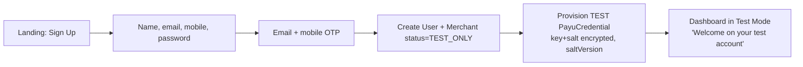
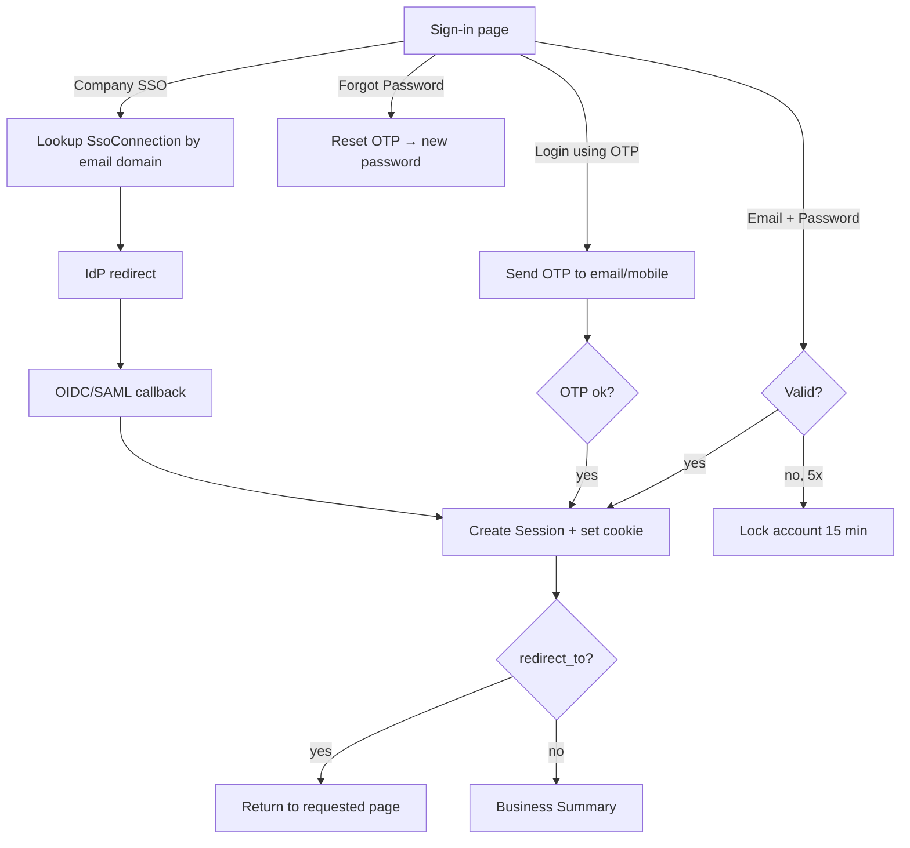
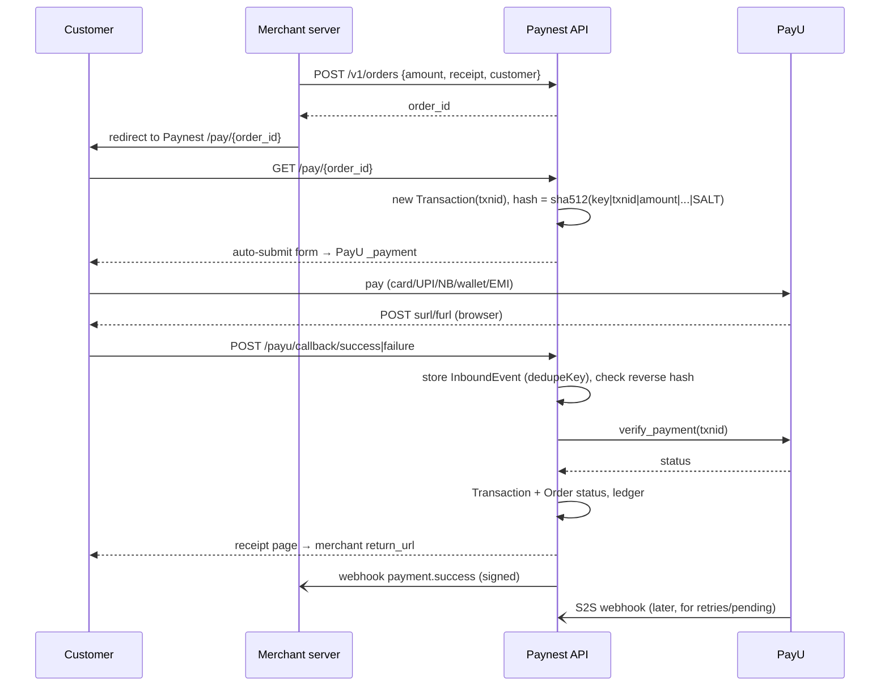
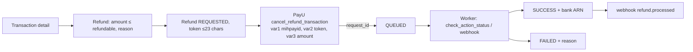
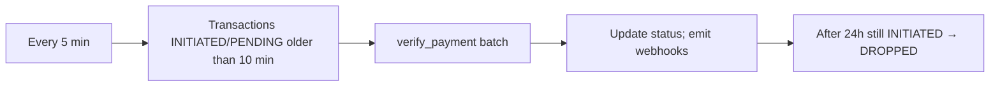

# User Flows

Actors: **Visitor**, **Merchant user** (Owner/Admin/Finance/Developer/Support/Viewer), **Customer** (the merchant's payer), **Paynest API**, **PayU**.

## 1. Sign up



Created: `User`, `Merchant`, `Membership(OWNER)`, five `OnboardingStep` rows (NOT_STARTED), `PayuCredential(mode=TEST, isDefault)`, `MerchantPaymentMethod` rows (TEST, enabled).

## 2. Sign in



The session stores the selected merchant (MID switcher) and the current **mode**.

## 3. Onboarding (test → live)

```mermaid
flowchart LR
  H[Home: Resume Onboarding] --> S1[PAN Details<br/>PAN, name on PAN, business type]
  S1 --> S2[Business Details<br/>legal name, category, address, GSTIN]
  S2 --> S3[Bank Account<br/>acct no, IFSC → penny-drop]
  S3 --> S4[Website Details<br/>URL/app, T&C, refund, privacy, contact pages]
  S4 --> S5[KYC Documents<br/>upload per business type]
  S5 --> SUB[Submit → partner onboarding API<br/>status=UNDER_REVIEW]
  SUB -->|approved| LIVE[merchant_credentials_issued webhook<br/>LIVE PayuCredential (salt_v2), status=LIVE]
  SUB -->|rejected/needs info| FIX[Step → REJECTED with remarks<br/>merchant edits & resubmits]
```

Progress % = verified-or-submitted steps ÷ 5. The **Payment Mode Status** card stays "Complete onboarding to activate" until the merchant is LIVE.

## 4. Choose integration

The home page offers **Hosted** (Paynest/PayU checkout page, about 1–2 days), **Merchant Hosted** (custom UI with server APIs, about 2–3 days) and **Plugins** (minutes). The choice is saved as `Merchant.integrationType` and decides which developer guide is shown.

## 5. Customer checkout (Hosted)



## 6. Refund



Only the Owner, Admin and Finance roles can refund. Each refund is written to `AuditLog`.

## 7. Settlement sync

A nightly worker pulls settlement data from PayU for each LIVE merchant, calls `GET /settlement/range` in 3-day windows, then upserts `Settlement` and its `SettlementLine` rows (capture/refund/chargeback lines with fee, tax and net) and posts balanced `LedgerEntry` journals. The Business Summary card "Total Settled Amount" reads these rows.

## 8. Reconciliation (stuck payments)



## 9. Payment link

Payment Tools → Create link (amount or open amount, description, customer, expiry) → `PaymentLink` + short URL → customer opens the link → the order is created → hosted checkout (flow 5) → the link becomes PAID (or PARTIALLY_PAID).

## 10. Developer setup

Developer page → see the test key, with the salt hidden until "Reveal" plus re-authentication → create a Paynest API key → add a webhook endpoint and secret → "Send test event" → view the delivery log.

## 11. Test/Live switch

The header toggle updates `Session.mode`. Every query is filtered by `mode`. Switching to Live before the merchant is LIVE shows the onboarding prompt instead of data.

## 12. Gateway health

A worker reads PayU downtime information and/or probe results into `GatewayDowntime`. The home widget shows open rows (Active Downtime) and the last 7 days of closed rows (Past Downtime). The Refresh button re-queries.
